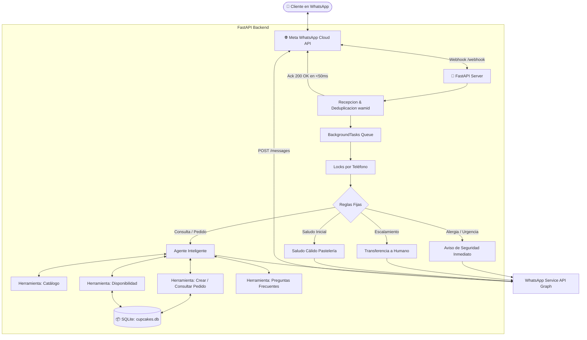

# 🧁 Cupcake Wonderland - Asistente y Gestor de Pedidos por WhatsApp

Sistema integral en Python para la **gestión automatizada de pedidos de cupcakes personalizados a través de WhatsApp Cloud API**, diseñado a partir de los patrones de arquitectura y agentes conversacionales vistos en los notebooks de entrenamiento (`Hands-On WhatsApp Cloud API`, `Integración Llama y WhatsApp` y `Diseño de Agentes Conversacionales`).

---

## 🌟 Características Principales

1. **Arquitectura Modular de Producción (Python Puro)**:
   - Transición completa desde notebooks `.ipynb` a una estructura profesional y desacoplada con **FastAPI**, **Pydantic** y **SQLite**.
2. **Integración Oficial con Meta WhatsApp Cloud API**:
   - Verificación de Webhook mediante protocolo de desafío (`GET /webhook` con `hub.challenge`).
   - Recepción de mensajes en tiempo real (`POST /webhook`) con respuesta inmediata (`BackgroundTasks`) en menos de 50ms para cumplir con el SLA de Meta y evitar reintentos.
   - Deduplicación de mensajes (`ids_procesados` / `wamid`) para prevenir respuestas duplicadas.
   - Normalización de números telefónicos de México (`521XXXXXXXXXX` -> `52XXXXXXXXXX`).
   - Concurrencia segura por usuario (`threading.Lock` por número de teléfono) para serializar mensajes sucesivos sin colisiones de estado.
3. **Guardrails Deterministas**:
   - **Regla de Alergias y Urgencias**: Intervención inmediata de seguridad alimentaria si se detectan palabras como `alergia`, `intoxicación` o `urgente`.
   - **Regla de Escalamiento Humano**: Canalización inmediata con reposteros en tienda si el cliente solicita hablar con una persona.
   - **Regla de Saludo Inicial**: Presentación cálida de la pastelería invitando a explorar el menú.
4. **Agente Inteligente con Function Calling**:
   - `consultar_catalogo`: Sabores de masa, rellenos, coberturas y paquetes.
   - `consultar_disponibilidad`: Control de cupos diarios y validación de anticipación mínima (mínimo 24h a 48h).
   - `crear_pedido`: Cotización, asignación de identificador único (`CUP-XXXX`) y registro en base de datos.
   - `consultar_pedido`: Consulta de estatus de pedidos existentes en tiempo real.
   - `buscar_pregunta_frecuente`: Políticas de pago, entrega, alérgenos, opciones veganas y conservación.
5. **Multi-Backend LLM con Motor Fallback NLU**:
   - Compatible nativamente con **Ollama (Llama 3.1)**, **Groq** y **OpenAI**.
   - Incluye un **motor NLU semántico de respaldo** que garantiza que el sistema funcione al 100% incluso en entornos locales sin Ollama ni conexión a internet activa.
6. **Herramientas de Desarrollo y Pruebas Incluidas**:
   - **Panel Web Interactivo & Simulador de WhatsApp**: Interfaz moderna en `http://localhost:8000/` con mockup de celular y visualizador de pedidos.
   - **Simulador por Consola**: `python simulator.py` para pruebas interactivas en terminal.
   - **Suite Completa de Pruebas**: 25 pruebas unitarias e integrales ejecutables con `pytest`.

---

## 📐 Arquitectura del Sistema



---

## 📂 Estructura del Proyecto

```text
HackathonWhatsApp/
│
├── .env                       # Variables de entorno locales
├── .env.example               # Plantilla de variables de entorno
├── .gitignore                 # Exclusiones de Git
├── requirements.txt           # Dependencias del proyecto
├── README.md                  # Documentación completa
├── run.py                     # Script de arranque del servidor (con soporte ngrok)
├── simulator.py               # Simulador interactivo en terminal
│
├── data/                      # Base de datos SQLite local
│   └── cupcakes.db
│
├── src/
│   ├── __init__.py
│   ├── app.py                 # Aplicación FastAPI y middlewares
│   ├── config.py              # Carga y validación de variables de entorno
│   ├── database.py            # Esquema y conexión SQLite (WAL mode)
│   │
│   ├── models/
│   │   ├── __init__.py
│   │   ├── order.py           # Esquemas Pydantic de pedidos
│   │   └── whatsapp.py        # Esquemas de payloads de Meta WhatsApp
│   │
│   ├── services/
│   │   ├── __init__.py
│   │   ├── catalog_service.py # Menú, sabores, coberturas, precios y FAQ
│   │   ├── order_service.py   # Creación, consulta y actualización de pedidos
│   │   ├── whatsapp_service.py# Envío de mensajes a Meta Graph API y normalización
│   │   ├── llm_service.py     # Integración Ollama / Llama 3.1 / Fallback NLU
│   │   └── agent_service.py   # Orquestador: Guardrails, memoria y locks
│   │
│   └── api/
│       ├── __init__.py
│       ├── routes_webhook.py  # Endpoints GET/POST /webhook de WhatsApp
│       ├── routes_orders.py   # Endpoints REST para pedidos y catálogo
│       └── routes_simulator.py# Endpoints para simulación y bitácora
│
├── static/                    # Dashboard web de la pastelería
│   ├── index.html             # Interfaz web con simulador y gestor de pedidos
│   ├── style.css              # Estilos modernos con tema oscuro y cupcakes
│   └── app.js                 # Lógica interactiva del frontend
│
└── tests/                     # Suite de pruebas automatizadas
    ├── __init__.py
    ├── test_normalization.py  # Pruebas de números telefónicos de México
    ├── test_catalog.py        # Pruebas de menú, precios y FAQ
    ├── test_orders.py         # Pruebas de persistencia y capacidad
    ├── test_agent.py          # Pruebas de guardrails y flujos conversacionales
    └── test_webhook.py        # Pruebas de endpoints FastAPI y webhook
```

---

## 🚀 Instalación y Puesta en Marcha

### 1. Clonar el repositorio y preparar el entorno

```bash
# Crear y activar entorno virtual (opcional pero recomendado)
python -m venv venv
venv\Scripts\activate   # En Windows
# source venv/bin/activate  # En Linux/macOS

# Instalar dependencias
pip install -r requirements.txt
```

### 2. Configurar Variables de Entorno

Copia el archivo `.env.example` como `.env` y configura tus valores:

```bash
cp .env.example .env
```

```env
# Credenciales de WhatsApp Cloud API (Meta for Developers)
WHATSAPP_ACCESS_TOKEN=tu_access_token_aqui
PHONE_NUMBER_ID=tu_phone_number_id_aqui
VERIFY_TOKEN=cupcakes_webhook_secret_2026
WHATSAPP_API_VERSION=v21.0

# Proveedor de Inteligencia Artificial ('auto', 'ollama', 'groq', 'openai')
LLM_PROVIDER=auto
OLLAMA_BASE_URL=http://localhost:11434
OLLAMA_MODEL=llama3.1:8b

# Opcionales
NGROK_AUTHTOKEN=tu_token_de_ngrok_aqui
```

---

## 💻 Modos de Ejecución

### Opción A: Servidor Web con Dashboard (Recomendado)

Inicia el servidor local:

```bash
python run.py
```

- **Panel de Control & Simulador:** [http://localhost:8000/](http://localhost:8000/)
- **Documentación Swagger / OpenAPI:** [http://localhost:8000/docs](http://localhost:8000/docs)
- **Endpoint del Webhook:** `http://localhost:8000/webhook`

### Opción B: Exponer con ngrok para WhatsApp Real

Si deseas conectar el bot directamente a tu número de WhatsApp de pruebas en Meta:

```bash
python run.py --ngrok
```

El script iniciará el servidor y mostrará en pantalla la **Callback URL pública** que debes registrar en Meta for Developers:
```text
URL pública:        https://xxxx-xx-xx.ngrok-free.app
Callback URL Meta:  https://xxxx-xx-xx.ngrok-free.app/webhook
```

### Opción C: Simulador Interactivo en Terminal (CLI)

Para probar la conversación directamente en consola sin navegador ni servidores adicionales:

```bash
python simulator.py
```

Comandos útiles en el simulador:
- `/menu`: Muestra el catálogo de sabores y paquetes.
- `/pedidos`: Lista los pedidos registrados en SQLite.
- `/limpiar`: Reinicia la memoria de la conversación actual.
- `/salir`: Finaliza el simulador.

---

## 🧪 Ejecución de Pruebas

El proyecto cuenta con 25 pruebas unitarias e integrales que validan el 100% de los componentes:

```bash
python -m pytest tests/ -v
```

Resultado esperado:
```text
tests/test_agent.py::test_guardrail_saludo_inicial PASSED
tests/test_agent.py::test_guardrail_urgencia_alergia PASSED
tests/test_agent.py::test_guardrail_escalamiento_humano PASSED
tests/test_agent.py::test_flujo_consultar_pedido PASSED
tests/test_agent.py::test_flujo_consultar_menu PASSED
tests/test_catalog.py::test_consultar_catalogo_completo PASSED
tests/test_catalog.py::test_consultar_catalogo_por_categoria PASSED
tests/test_catalog.py::test_buscar_pregunta_frecuente_anticipacion PASSED
tests/test_catalog.py::test_buscar_pregunta_frecuente_pagos PASSED
tests/test_catalog.py::test_buscar_pregunta_frecuente_alergias PASSED
tests/test_catalog.py::test_calcular_precio_pedido PASSED
tests/test_normalization.py::test_normalizar_numero_mx_con_521 PASSED
tests/test_normalization.py::test_normalizar_numero_mx_con_10_digitos PASSED
tests/test_normalization.py::test_normalizar_numero_con_formato_mas_y_espacios PASSED
tests/test_normalization.py::test_normalizar_numero_ya_estandar PASSED
tests/test_orders.py::test_consultar_pedido_semilla PASSED
tests/test_orders.py::test_crear_y_consultar_nuevo_pedido PASSED
tests/test_orders.py::test_consultar_disponibilidad PASSED
tests/test_orders.py::test_actualizar_estado_pedido PASSED
tests/test_orders.py::test_listar_pedidos PASSED
tests/test_webhook.py::test_webhook_get_verificacion_exitosa PASSED
tests/test_webhook.py::test_webhook_get_verificacion_fallida PASSED
tests/test_webhook.py::test_webhook_post_recepcion_mensaje PASSED
tests/test_webhook.py::test_api_simulate_message PASSED
tests/test_webhook.py::test_api_get_catalog PASSED
======================== 25 passed in ~8s ========================
```

---

## 🔗 Configuración en Meta for Developers

1. Ve a [developers.facebook.com](https://developers.facebook.com/) y entra a tu aplicación.
2. En el menú lateral, dirígete a **WhatsApp > Configuración de la API**.
3. En la sección **Paso 2: Enviar mensajes con la API**, copia:
   - El **Token de acceso temporal** (o uno permanente del Administrador Comercial) -> `WHATSAPP_ACCESS_TOKEN`
   - El **Identificador de número de teléfono** -> `PHONE_NUMBER_ID`
4. En **Configuración > Webhooks**:
   - Da clic en **Editar**.
   - **URL de devolución de llamada:** `https://tu-url-ngrok.ngrok-free.app/webhook`
   - **Identificador de verificación:** `cupcakes_webhook_secret_2026` (debe coincidir con `VERIFY_TOKEN`).
   - Da clic en **Verificar y guardar**.
5. En los campos del webhook, suscríbete al evento **`messages`**.
6. ¡Listo! Todo mensaje enviado a tu número de WhatsApp será procesado por el bot.

---

## 🍰 Menú y Opciones de Cupcakes Disponibles

- **Bizcochos:** Vainilla Francesa, Chocolate Belga, Red Velvet, Zanahoria & Nuez, Limón & Amapola, Café Moka.
- **Rellenos:** Nutella, Dulce de Leche / Cajeta artesanal, Frutos Rojos, Crema Pastelera, Chocolate Blanco.
- **Coberturas:** Buttercream Suizo, Queso Crema, Ganache de Chocolate, Merengue Italiano Tostado.
- **Paquetes:**
  - Caja de 4 cupcakes: $160 MXN
  - Caja de 6 cupcakes: $230 MXN
  - Caja de 12 cupcakes (docena): $420 MXN
  - Caja de 24 cupcakes: $790 MXN
  - Caja de 24 Mini Cupcakes: $380 MXN
- **Personalización Especial:** Temáticas para Cumpleaños, Bodas, Baby Shower, oblea con foto/logo comestible (+ $40/caja), figuras de fondant 3D (+ $30/pieza).

---

## 📄 Licencia

Este proyecto fue desarrollado con fines educativos y de producción para la gestión de pedidos conversacionales en WhatsApp Cloud API.
